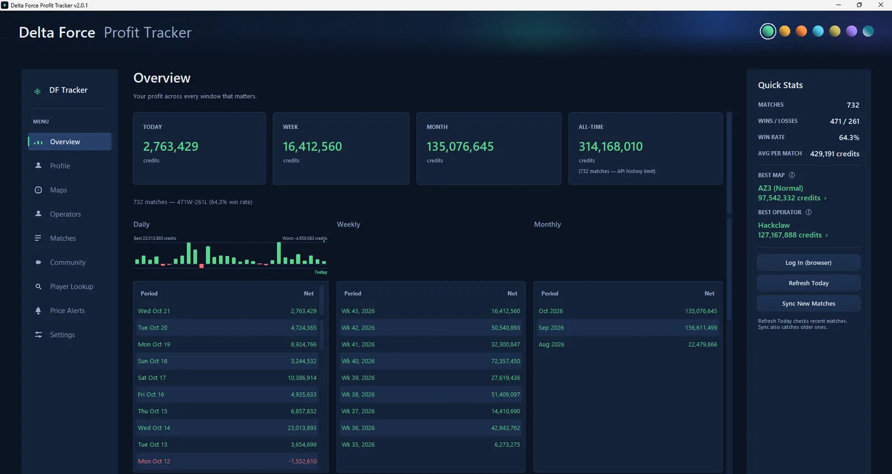
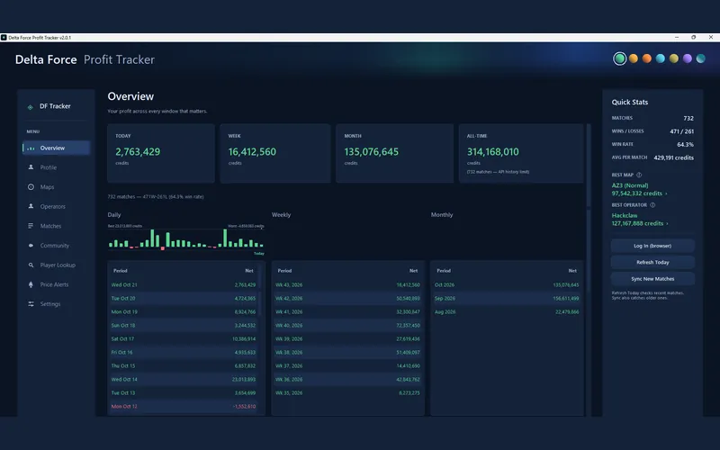
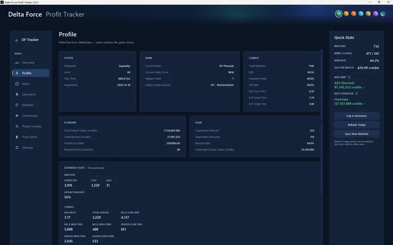
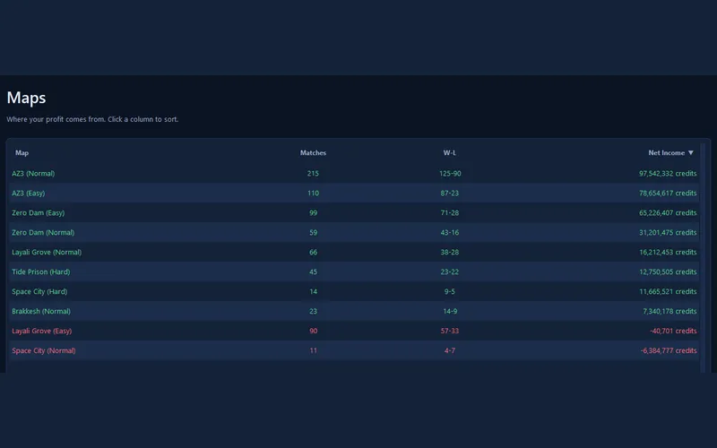
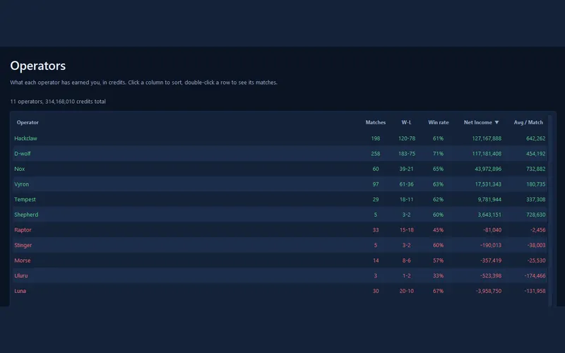
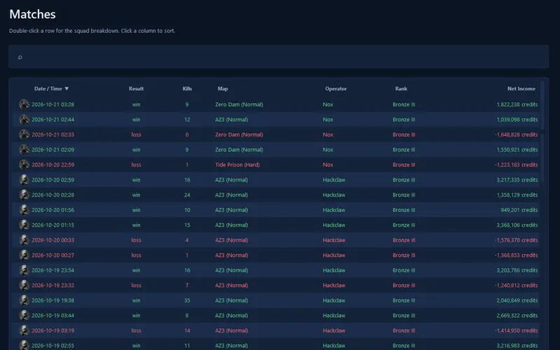
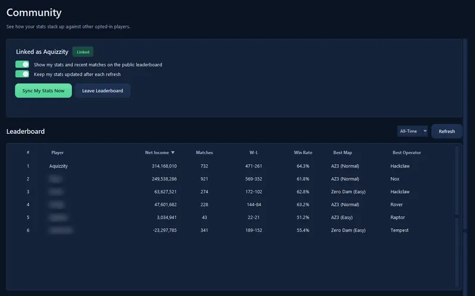
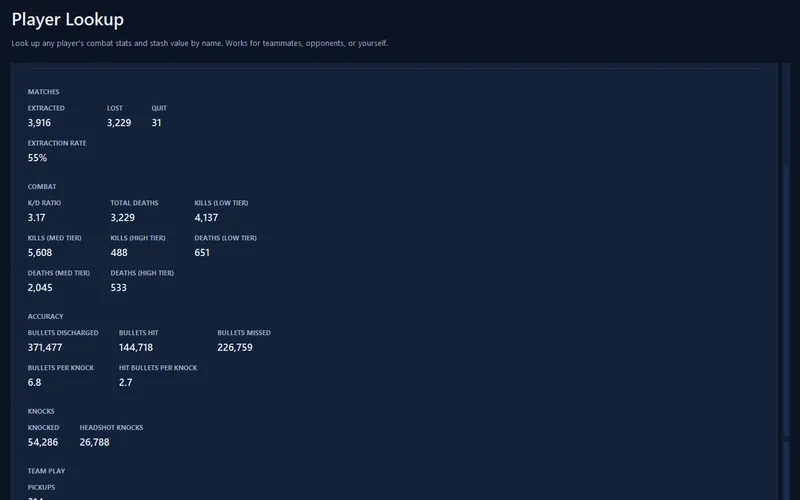
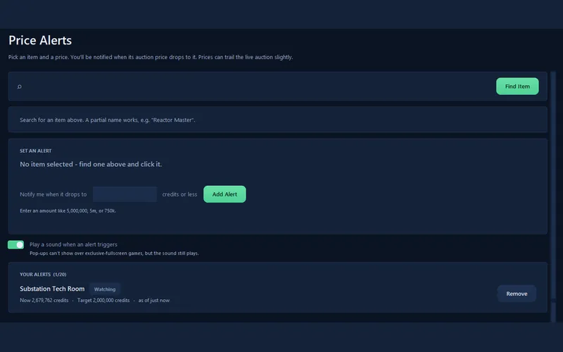

# DF Tracker: Delta Force profit tracker

Track what every Delta Force match actually pays. DF Tracker is a Windows app that adds up your credits for every match and shows where your profit really comes from, by map and by operator. Press a hotkey to see your profit or look up a player without leaving the game, and get an alert when an item you want drops to your price.

**[Download for Windows](https://github.com/VsatCS2/Delta-Force-Profit-Tracker/releases/latest)** · [Website and tour](https://vsatcs2.github.io/Delta-Force-Profit-Tracker/) · [Privacy](https://vsatcs2.github.io/Delta-Force-Profit-Tracker/privacy.html) · [Report a problem](https://github.com/VsatCS2/Delta-Force-Profit-Tracker/issues)

[](https://vsatcs2.github.io/Delta-Force-Profit-Tracker/)

## What it does

- **Overview:** what you've made today, this week, this month and all time, with daily, weekly and monthly breakdowns.
- **Maps and operators:** net income, wins and losses for every map, and win rate and average profit per match for every operator.
- **Match history:** every match with its result, kills, operator, rank and net income, plus a squad breakdown for each one.
- **Play sessions and weekly highlights:** track a block of play on its own, and see your evac rate, K/D, best and worst squad-mates and best raid of the week.
- **Profile and extended stats:** your game profile, rank, accuracy, knocks and stash value.
- **Overlays:** two small windows with their own hotkeys, both off until you turn them on in Settings. **Ctrl+Shift+D** shows your profit, and **Ctrl+Shift+O** looks up a player by name. Like any pop-up window they can't show over exclusive fullscreen, so play in windowed or borderless mode.
- **Price alerts:** pick an item and the price you'd like to *buy* it at, and get notified when its auction price drops to that price or lower.
- **Player lookup:** a player's combat stats and stash value by name (uses a free DF Tracker account, see below).
- **Community leaderboard (optional):** compare with other players under your in-game nickname.
- **Also:** auto-refresh, system tray, automatic updates, CSV export of your match history, Discord Rich Presence, and seven color themes.

## Screenshots

| | |
|---|---|
| [](docs/media/overview-full.webp)<br>**Overview** | [](docs/media/profile-full.webp)<br>**Profile** |
| [](docs/media/maps-full.webp)<br>**Maps** | [](docs/media/operators-full.webp)<br>**Operators** |
| [](docs/media/matches-full.webp)<br>**Match history** | [](docs/media/community-full.webp)<br>**Community leaderboard** |
| [](docs/media/player-lookup-full.webp)<br>**Player lookup** | [](docs/media/price-alerts-full.webp)<br>**Price alerts** |

*The screens show one player's real match data. Other players' names are blurred.*

## Install

You need Windows 10 or 11.

1. Download **`DeltaForceTracker-Setup-<version>.exe`** from the [latest release](https://github.com/VsatCS2/Delta-Force-Profit-Tracker/releases/latest).
2. Run it. It installs just for you (no administrator prompt), adds a Start menu entry, and can be removed any time under **Settings → Apps**. Your settings and match history are stored separately, so installing or uninstalling never touches them.
3. Open DF Tracker and sign in with your Delta Force account so your matches load.

Prefer a portable copy? Download **`DeltaForceTracker.zip`** from the same page, extract the **whole** folder (not just the `.exe`), and run `DeltaForceTracker.exe`.

**Updating:** from 1.5.0 onward the app updates itself. Open **Settings → Check for Updates**.

**If Windows warns you:** DF Tracker isn't code-signed yet, so Windows may show "Windows protected your PC" (SmartScreen). Choose **More info → Run anyway**. Windows 11's Smart App Control, if it's switched on, can't allow individual apps and may block the installer. Each release has a `.sha256` file so you can check that your download is the published one:

```
certutil -hashfile DeltaForceTracker-Setup-<version>.exe SHA256
```

## Signing in

There are two separate sign-ins, and only the first is needed to track your own matches.

- **Your game account.** Sign in with your Delta Force (Level Infinite) account so DF Tracker can pull your matches. Your password goes only to Level Infinite's login, never to DF Tracker's servers.
- **A DF Tracker account (optional).** Sign in with Discord in Settings to use player lookup and the player search overlay. It lets our server know who is looking up players, so lookups can be limited fairly per person. It is separate from your game account.

## Your data and privacy

- Your match history, settings and caches stay on your PC.
- A DF Tracker account stores what Discord provides when you sign in (your Discord ID, email address, display name and avatar), your plan, how many lookups you've used each day, and any admin notes about the account.
- If you join the community leaderboard, your Overview totals and recent matches are shared under your in-game nickname. You can leave any time from the app.
- You can ask for your account and its data to be deleted. The [privacy page](https://vsatcs2.github.io/Delta-Force-Profit-Tracker/privacy.html) has the full details.

## Run from source

You need Windows and Python 3.12 or newer.

```
git clone https://github.com/VsatCS2/Delta-Force-Profit-Tracker.git
cd Delta-Force-Profit-Tracker
pip install -r requirements.txt
python delta_force_gui.py
```

## Community leaderboard server

The optional leaderboard runs on a small server (`app.py`). You don't need to run it yourself, because the app connects to a hosted one. If you want your own, see [COMMUNITY_SERVER.md](COMMUNITY_SERVER.md).

## Third-party data and affiliation

- Your own match data comes from the official Delta Force stats service. Player lookups and the search overlay use a third-party game-data API through DF Tracker's server. Extended Stats and Price Alerts use [deltaforceapi.com](https://deltaforceapi.com), an independent third-party service.
- DF Tracker is an independent, fan-made project. It is not affiliated with, endorsed by, or sponsored by Level Infinite, Proxima Beta, or the developers of Delta Force. Delta Force and related names and marks belong to their respective owners. Please read [DISCLAIMER.md](DISCLAIMER.md).

## License

[MIT](LICENSE). Third-party software notices are in [THIRD_PARTY_NOTICES.txt](THIRD_PARTY_NOTICES.txt).
